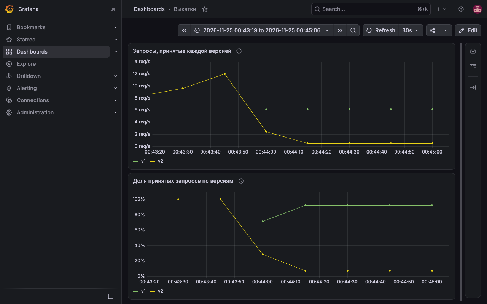
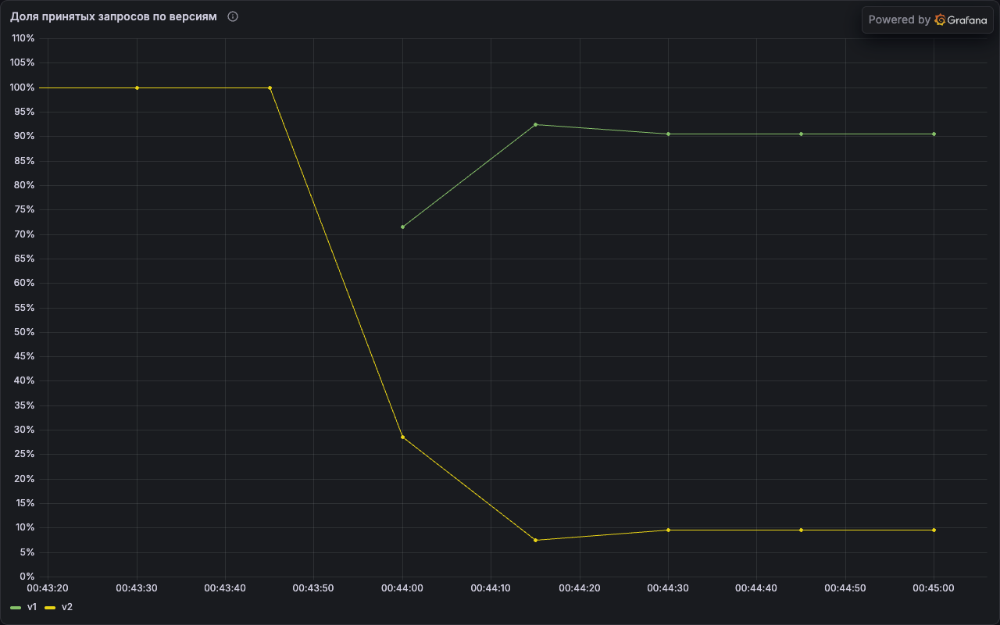

# Canary 90/10 в Bookshop

Через Envoy Gateway отправили 500 запросов `GET /books`. В маршруте Canary задали веса 90 для `v1` и 10 для `v2`.

| Версия | Заданный вес | Ожидаемо из 500 | Фактически | Фактическая доля |
|---|---:|---:|---:|---:|
| `v1` | 90 | 450 | 449 | 89,8% |
| `v2` | 10 | 50 | 51 | 10,2% |

Все 500 запросов получили HTTP 200.

## Скриншоты Grafana

Дашборд показывает скорость и долю запросов по версиям.

График показывает, как доли запросов к `v1` и `v2` приблизились к 90/10.

## Вывод

Фактическое распределение составило **89,8% / 10,2%**. От заданных долей оно отклонилось на один запрос в каждую сторону (0,2 процентного пункта). Таблица отражает все 500 ответов зачётной серии, а каждая точка Grafana показывает оценку за скользящую минуту.
